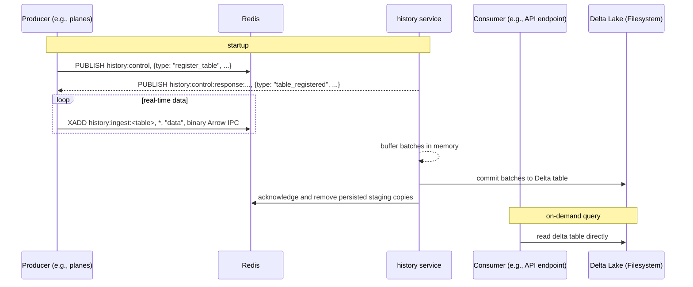

# History Plugin

The `tangram_history` plugin provides a centralized, durable persistence layer for tangram. It ingests high-frequency, append-only time-series data from producer plugins (like [`tangram_jet1090`](./jet1090.md) or [`tangram_ship162`](./ship162.md)) and stores it efficiently in [Delta Lake tables](https://delta.io/blog/delta-lake-vs-parquet-comparison/).

- buffers incoming records in memory and flushes them periodically as larger, optimized parquet files.
- uses Delta Lake for transactional writes, schema enforcement, and compatibility with query engines (datafusion, polars, duckdb...).
- makes no assumptions about data content: producers register their own schemas and data retention policies.



## Protocol

### Control channel (`history:control`)

Used for managing tables. Producers must register a table and its schema before sending data.

- message: `register_table`
- payload fields:
  - `sender_id`: a unique id for the producer instance.
  - `table_name`: a unique name for the table (e.g., `"aircraft_states"`).
  - `schema`: base64-encoded arrow ipc **schema** bytes.
  - `partition_columns`: list of column names to partition by.
  - `optimize_interval_secs`: how often to run `optimize`.
  - `vacuum_interval_secs`: how often to run `vacuum`.
  - `vacuum_retention_period_secs`: retention for `vacuum`.

### Ingest stream (`history:ingest:<table_name>`)

A Redis stream where producers stage batches until they are committed to the
Delta table. It is a buffer, **not the persistent history archive**: the
archive is the Delta/Parquet data on disk, read directly by the trajectory,
history and search APIs and by trail backfill. Live position tracking never
reads it.

- command: `XADD`
- payload: a key-value pair `data` containing binary Arrow IPC record batches in stream format.

#### Cleanup after a durable commit

Once a batch is committed to Delta, the consumer acknowledges it and removes
its copy from the stream. On Redis 8.2 or newer this is one atomic
`XACKDEL ACKED` call, which never deletes an entry another consumer group
still needs. On older servers, an atomic Lua fallback deletes only the IDs
that were actually acknowledged, and only when the history group is the sole
group on the stream; with additional groups it keeps the payloads and logs a
warning rather than risk another consumer's data.

Acknowledgement alone frees nothing: `XACK` clears bookkeeping, not payloads.
Before this cleanup existed, acknowledged batches stayed in Redis forever,
which is what eventually exhausted its memory.

#### Failure and delivery semantics

Malformed payloads and failed disk writes are never acknowledged or deleted.
Failed commits are retried with bounded backoff, and so is the cleanup after a
successful commit; a retry never rewrites a batch that is already on disk.
Delivery is **at least once**, not exactly once: an uncertain commit, or the
reclaim of entries belonging to a slow or stopped worker, can write the same
rows twice. Consumers should tolerate duplicates.

Entries idle for more than 60 seconds are reclaimed with `XAUTOCLAIM` after a
consumer stops, which requires Redis 6.2 or later. This cleanup only concerns
the staging stream: it deletes no saved history, and no `MAXLEN` or age-based
eviction is ever applied.

#### Monitoring

A persistently slow or unavailable sink still lets unprocessed batches pile
up. Watch consumer lag, the pending entry count, stream length and Redis
memory: zero lag on a growing stream means processed data is not being
removed. Whether unprocessed staging survives a Redis crash depends on
Redis's own durability settings. Producers publish with a separate
bounded-retry policy; nothing here guarantees lossless recording before Redis
accepts a batch.

## Configuration

The history service itself has minimal configuration. All per-table settings are provided by the producer plugins that use it.

```toml title="tangram.toml"
[core]
plugins = ["tangram_history", "tangram_jet1090"]

# global settings for the history service
[plugins.tangram_history]
# base path on the local filesystem for storing delta tables.
base_path = "/tmp/tangram_history"
# redis channel for control messages.
control_channel = "history:control"

# producer-specific settings
[plugins.tangram_jet1090]
history_table_name = "jet1090"
history_flush_interval_secs = 5
# ... other history settings for this table
```

See [`tangram_history.HistoryConfig`][] for all available options.

!!! warning

    Note that the [Delta Lake protocol](https://github.com/delta-io/delta/blob/master/PROTOCOL.md#primitive-types) only supports a subset of [Parquet primitive types](https://github.com/apache/parquet-format/blob/master/LogicalTypes.md#numeric-types).

    Notably, **unsigned integers are not supported**. To avoid data loss or unexpected wrap-around, ensure your producers use signed integer types (e.g., `i32`, `i64`) when defining schemas and generating Arrow record batches.
